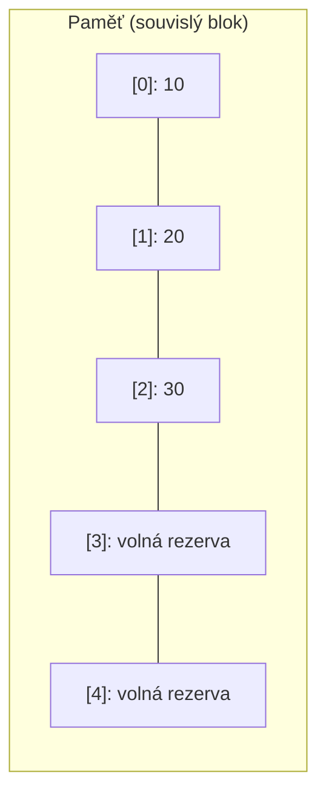
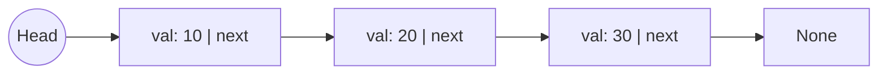
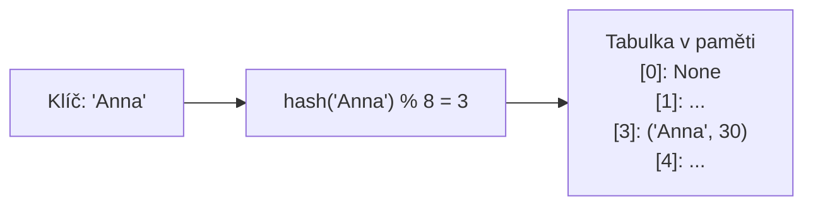
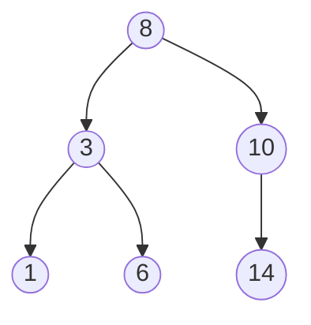
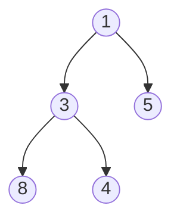
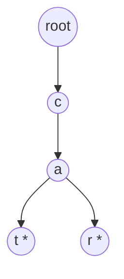

## 1. Jak o datových strukturách přemýšlet

Datová struktura není jen „typ proměnné“. Je to **způsob uspořádání dat v paměti**, který přímo určuje, co bude program dělat bleskově a co ho naopak úplně zabrzdí.

V zásadě existují dva základní způsoby uložení dat v paměti:
1. **Souvislý blok paměti (*contiguous memory*):** Prvky leží těsně vedle sebe (např. `list`, `tuple`, `str`). Díky tomu počítač okamžitě vypočítá adresu $i$-tého prvku, ale vkládání doprostřed znamená posouvání ostatních prvků.
2. **Propojené uzly (*linked / pointer-based*):** Prvky jsou rozházené různě v paměti a drží pohromadě pomocí odkazů/ukazatelů (*pointers*) na další prvky (např. `Linked List`, stromy, grafy). Vkládání je snadné pouhým přepojením odkazu, ale neumíme skočit přímo na $i$-tý prvek bez procházení.

> [!INFO] Proč je to v Pythonu specifické?
> V Pythonu je téměř vše objekt. Například Python `list` neukládá přímo celá čísla vedle sebe jako pole v jazyce C, ale ukládá v souvislém bloku paměti **ukazatele (reference)** na objekty v paměti. Díky tomu může mít v jednom seznamu různé datové typy (`[1, "ahoj", 3.14]`).

---

## 2. Big O notace – jazyk výkonnosti

**Big O** neudává čas v sekundách (ten závisí na hardwaru), ale **jak rychle roste počet operací (čas) nebo spotřeba paměti (prostor)** s rostoucím počtem prvků $n$. Vždy se ptáme na **nejhorší případ** (*worst-case*), pokud není řečeno jinak (např. průměrný případ u hash tabulek).

### Přehled složitostí (od nejlepší po nejhorší)

| Big O | Název | Chování při $n = 1\,000\,000$ | Typický příklad |
| :--- | :--- | :--- | :--- |
| **$O(1)$** | Konstantní | $1$ operace | Přístup přes index `arr[5]`, hledání klíče v `dict` (průměrně) |
| **$O(\log n)$** | Logaritmická | $\approx 20$ operací | Binární vyhledávání v seřazeném poli, operace v BST / haldě |
| **$O(n)$** | Lineární | $1\,000\,000$ operací | Průchod polem `for x in arr`, `x in list` |
| **$O(n \log n)$** | Linearitmická | $\approx 20\,000\,000$ operací | Efektivní řazení (`sorted()`, `list.sort()` – Timsort, Merge sort) |
| **$O(n^2)$** | Kvadratická | $10^{12}$ operací (pomalé!) | Vnořené smyčky (`for` uvnitř `for`), kontrola duplicit přes `list` |
| **$O(2^n)$** | Exponenciální | Prakticky neřešitelné pro $n > 30$ | Naivní rekurze bez memoizace, generování všech podmnožin |

> [!TIP] Tři zlatá pravidla Big O pro pohovory
> 1. **Konstanty škrtáme:** $O(2n)$ i $O(n + 500)$ je prostě $O(n)$. $O(500)$ je $O(1)$.
> 2. **Zůstává jen dominantní člen:** $O(n^2 + n)$ zjednodušíme na $O(n^2)$, protože pro velké $n$ je $n$ zanedbatelné.
> 3. **Pozor na skryté smyčky v Pythonu:** Řádek `if x in my_list:` nevypadá jako smyčka, ale uvnitř dělá lineární průchod $O(n)$! Pokud ho dáš do `for` smyčky, máš nechtěně $O(n^2)$.

---

## 3. Základní datové struktury

### 3.1 Array / Dynamic Array (`list` v Pythonu)
Dynamické pole ukládá prvky do souvislého bloku paměti. Aby nemuselo při každém `append()` kopírovat celé pole na nové místo, alokuje si v paměti **rezervu (over-allocation)**. Když rezerva dojde, vytvoří se větší pole (typicky ~1,125× až 2× větší), prvky se překopírují a uvolní se staré místo.



- **Přístup podle indexu (`arr[i]`):** $O(1)$ – stačí přičíst $i$ k adrese začátku.
- **Přidání/odebrání z konce (`append`, `pop()`):** **amortizovaně $O(1)$** (většinou hned, občas pomalejší realokace, v průměru konstantní).
- **Vložení/odebrání ze začátku nebo středu (`insert(0, x)`, `pop(0)`):** $O(n)$ – všechny prvky za tímto místem se musí v paměti posunout!
- **Vyhledávání (`x in arr`):** $O(n)$ – musí projít prvky postupně.

```python
nums = [10, 20, 30]
nums.append(40)      # O(1) amortizovaně
last = nums.pop()    # O(1) - odebere 40
nums.insert(0, 99)   # O(n) - POZOR, posouvá celé pole!
val = nums[2]        # O(1)
```

---

### 3.2 Tuple (`tuple`) a String (`str`) – Neměnné (Immutable) sekvence
V paměti fungují podobně jako pole (přístup přes index je $O(1)$), ale **po vytvoření je nelze změnit**.

- **`tuple`:** Pevná n-tice hodnot. Zabírá méně paměti než `list`, je mírně rychlejší a hlavně – **může být klíčem v `dict` nebo prvkem v `set`** (pokud obsahuje jen neměnné prvky). Používá se pro strukturované záznamy, např. souřadnice `(x, y)`.
- **`str`:** Neměnná sekvence znaků. Přístup `s[i]` je $O(1)$, *slicing* `s[a:b]` vytváří nový řetězec o délce $k = b - a$, takže trvá $O(k)$.

> [!WARNING] Past při skládání stringů ve smyčce!
> Protože je `str` neměnný, opakované `s = s + znak` ve smyčce musí pokaždé vytvořit nový řetězec a zkopírovat ten starý $\implies$ celková složitost $O(n^2)$.  
> **Správné řešení v Pythonu:** Sbírej části do seznamu a na konci spoj přes `"".join(parts)` $\implies$ **$O(n)$**.

```python
# Špatně: O(n^2)
res = ""
for ch in ["a", "b", "c"]:
    res += ch

# Správně: O(n)
parts = []
for ch in ["a", "b", "c"]:
    parts.append(ch)
res = "".join(parts)
```

---

### 3.3 Linked List (Zřetězený seznam)
Skládá se z uzlů (**Nodes**), kde každý uzel nese hodnotu (`val`) a ukazatel (`next`) na následující uzel (u *Doubly Linked Listu* navíc i `prev` na předchozí).



- **Přístup k $i$-tému prvku / vyhledávání:** $O(n)$ – musíme jít od začátku (`head`) krok po kroku.
- **Vložení/smazání na začátek:** $O(1)$ – jen přepojíme `head`.
- **Vložení/smazání za známý uzel:** $O(1)$ – stačí přepsat ukazatel `next`.
- **Nevýhoda v praxi:** Nemá $O(1)$ indexování, má větší paměťovou režii (ukazatele) a horší *CPU cache locality* než pole. V Pythonu se téměř nepoužívá přímo, ale je základem pro `deque` a častým tématem na SWE pohovorech.

```python
class Node:
    def __init__(self, val, next_node=None):
        self.val = val
        self.next = next_node

# Vytvoření seznamu: 1 -> 2 -> 3
head = Node(1, Node(2, Node(3)))

# Vložení na začátek v O(1): 0 -> 1 -> 2 -> 3
new_node = Node(0)
new_node.next = head
head = new_node
```

---

### 3.4 Stack (Zásobník) – LIFO
Princip **Last In, First Out** (jako hromada talířů – bereš vždy ten horní).
- **Operace:** `push` (vlož nahoru), `pop` (odeber shora), `peek` (podívej se na horní) $\implies$ všechny **$O(1)$**.
- **Implementace v Pythonu:** Stačí obyčejný `list` (`append()` a `pop()`).
- **Typické použití:** Zpět/Vpřed (*Undo/Redo*), zásobník volání funkcí (*Call Stack*), kontrola správného uzávorkování `({[]})`, prohledávání do hloubky (*DFS*).

```python
stack = []
stack.append("A")    # push -> ['A']
stack.append("B")    # push -> ['A', 'B']
top = stack[-1]      # peek -> 'B' (O(1))
item = stack.pop()   # pop  -> 'B', zbývá ['A'] (O(1))
```

---

### 3.5 Queue (Fronta) – FIFO
Princip **First In, First Out** (jako fronta v obchodě – kdo první přijde, první je obsloužen).
- **Operace:** `enqueue` (zařaď na konec), `dequeue` (vyřaď ze začátku) $\implies$ musí být **$O(1)$**.
- **Implementace v Pythonu:** Vždy použij `collections.deque` (*double-ended queue*, interně realizována jako obousměrně zřetězený seznam pevných bloků). **Nikdy** nepoužívej pro frontu `list.pop(0)`, protože je to $O(n)$!
- **Pozor:** Přístup doprostřed `deque[i]` trvá $O(n)$.
- **Typické použití:** Zpracování úloh na pozadí (*task queues*), streamování dat, prohledávání do šířky (*BFS*).

```python
from collections import deque

queue = deque(["A", "B"])
queue.append("C")        # enqueue na konec -> O(1)
first = queue.popleft()  # dequeue ze začátku -> 'A', O(1)
```

---

### 3.6 Hash Table (`dict`) a Hash Set (`set`)
Nejdůležitější datové struktury pro rychlé vyhledávání v Pythonu i datové analýze.

**Jak fungují uvnitř:**
1. Klíč (např. `"Anna"`) projde **hashovací funkcí** (`hash("Anna")`), která z něj deterministicky vyrobí velké číslo.
2. Pomocí operace modulo (`hash % velikost_tabulky`) se číslo převede na **index v interním poli (tzv. bucket / slot)**.
3. Pokud dva různé klíče spadnou do stejného slotu, vzniká **kolize** (*collision*). Řeší se buď řetězením (*chaining* – seznam v jednom slotu), nebo otevřeným adresováním (*open addressing* – hledání dalšího volného slotu; používá Python CPython).



- **Vyhledání, vložení, smazání:** Průměrně **$O(1)$**, nejhorší případ (při masivních kolizích) $O(n)$.
- **Podmínka pro klíč (`dict`) / prvek (`set`):** Musí být **hashovatelný** (*immutable* – např. `int`, `str`, `tuple` ze stejných typů). `list` nebo `dict` jako klíč použít nelze!
- **Rozdíl `dict` vs `set`:**
  - `dict`: ukládá páry `klíč: hodnota` (od Pythonu 3.7 zachovává pořadí vložení).
  - `set`: ukládá jen unikátní klíče bez hodnot (jako `dict` bez hodnot). Skvělé pro deduplikaci, rychlé `x in my_set` ($O(1)$) a množinové operace (průnik `&`, sjednocení `|`, rozdíl `-`).

```python
# Dictionary (Hash Table)
ages = {"John": 25, "Anna": 30}
print("Anna" in ages)      # O(1) průměrně
val = ages.get("Petr", 0)  # bezpečné čtení bez KeyError

# Set (Hash Set)
a = {1, 2, 3, 3}           # {1, 2, 3}
b = {3, 4, 5}
print(2 in a)              # O(1) průměrně
print(a & b)               # průnik: {3}
print(a - b)               # rozdíl: {1, 2}
```

> [!TIP] Praktické varianty `dict` ze standardní knihovny `collections`
> - `Counter(seznam)`: okamžitě spočítá četnosti prvků v $O(n)$.
> - `defaultdict(list)`: při přístupu k neexistujícímu klíči automaticky založí prázdný list (skvělé pro seskupování dat).

---

## 4. Pokročilejší datové struktury

U juniorních pozic (zejména DE, SWE, Python Dev) nemusíš umět napsat vyvažování stromů z hlavy, ale musíš chápat **princip, složitost a kdy je použít**.

### 4.1 Binary Tree a Binary Search Tree (BST)
- **Binary Tree (Binární strom):** Hierarchická struktura z uzlů, kde každý uzel má **maximálně 2 potomky** (`left`, `right`). Začíná v kořeni (*root*), končí v listech (*leaves*).
- **Binary Search Tree (BST):** Binární strom s uspořádáním: pro každý uzel platí, že **vše v levém podstromu je menší** a **vše v pravém podstromu je větší**.



- **Vyhledávání / vkládání / mazání:**
  - Pokud je strom **vyvážený**: v každém kroku zahodíme polovinu stromu $\implies$ **$O(\log n)$**.
  - Pokud je strom **degenerovaný** (např. vkládáme už seřazená čísla `1, 2, 3, 4`): vznikne z něj vlastně Linked List $\implies$ **$O(n)$**.
- **Průchody stromem:**
  - **DFS (do hloubky):** *Inorder* (levý → uzel → pravý; u BST vypíše prvky seřazeně!), *Preorder* (uzel → levý → pravý), *Postorder* (levý → pravý → uzel).
  - **BFS (do šířky / *level-order*):** po patrech shora dolů (pomocí fronty `deque`).

---

### 4.2 Balanced Tree (Samovyvažovací stromy)
Řeší hlavní slabinu BST (degradaci na $O(n)$). Při vkládání nebo mazání automaticky provádějí tzv. **rotace**, aby udržely výšku stromu kolem $\log n$.
- Příklady: **AVL Tree** (striktně vyvážený), **Red-Black Tree** (méně rotací, používá se v C++ `std::map` nebo Java `TreeMap`), **B-Tree / B+ Tree** (více klíčů v jednom uzlu – **základ indexů v SQL databázích**, např. PostgreSQL, MySQL).
- **Garantovaná složitost:** vyhledávání, vložení i mazání vždy **$O(\log n)$**.
- **Využití:** Databázové indexy, udržování průběžně seřazených dat s dotazy na rozsahy (*range queries*: „najdi všechny záznamy mezi 100 a 500“ – to `dict` neumí!).

---

### 4.3 Heap (Halda / Prioritní fronta)
Speciální kompletní binární strom (zaplněný po patrech zleva doprava), kde platí vlastnost haldy:
- **Min-Heap:** Každý rodič je **menší nebo roven** svým potomkům $\implies$ nejmenší prvek je vždy v kořeni (`heap[0]`).
- **Max-Heap:** Každý rodič je **větší nebo roven** svým potomkům $\implies$ největší prvek v kořeni.



**Chytré uložení:** Halda se neukládá pomocí objektů a ukazatelů, ale přímo v obyčejném poli (`list`)! Pro prvek na indexu $i$ jsou potomci na $2i + 1$ a $2i + 2$.

- **Zjištění minima (`heap[0]`):** $O(1)$
- **Vložení (`heappush`) / odebrání minima (`heappop`):** $O(\log n)$
- **Vytvoření haldy ze seznamu (`heapify`):** **$O(n)$** (překvapivě lineární, ne $O(n \log n)$!)
- **Využití:** Prioritní fronty (plánování úloh), hledání **Top-K** největších/nejmenších prvků, Dijkstrův algoritmus pro nejkratší cestu.

```python
import heapq

nums = [5, 2, 8, 1, 9]
heapq.heapify(nums)           # O(n) -> přeuspořádá list in-place na Min-Heap
print(nums[0])                # 1 (minimum v O(1))

heapq.heappush(nums, 0)       # O(log n)
smallest = heapq.heappop(nums)# O(log n) -> vrátí 0

# Trik pro Max-Heap v Pythonu (heapq umí jen Min-Heap): ukládej záporné hodnoty!
max_heap = []
for x in [5, 2, 8]:
    heapq.heappush(max_heap, -x)
largest = -heapq.heappop(max_heap)  # 8
```

---

### 4.4 Graph (Graf)
Obecná síť skládající se z **vrcholů** (*nodes / vertices*, $V$) a **hran** (*edges*, $E$). Na rozdíl od stromu může obsahovat cykly a nemá nutně jeden kořen.

**Základní typy grafů:**
- **Neorientovaný (*undirected*):** Přátelství na sociální síti ($A \leftrightarrow B$).
- **Orientovaný (*directed*):** Sledování na Instagramu, silnice s jednosměrkami ($A \to B$).
- **Ohodnocený (*weighted*):** Hrany mají váhu (vzdálenost, cenu, čas).
- **DAG (*Directed Acyclic Graph*):** Orientovaný graf bez cyklů. **Naprostý základ v Data Engineeringu** (závislosti kroků v Apache Airflow, Spark, dbt).

**Reprezentace grafu v Pythonu:**
1. **Seznam sousedů (*Adjacency List* – nejčastější):** Slovník, kde klíčem je vrchol a hodnotou seznam/množina sousedů. Úsporný pro řídké grafy ($O(V + E)$ paměti).
   ```python
   graph = {
       "A": ["B", "C"],
       "B": ["D"],
       "C": ["D"],
       "D": []
   }
   ```
2. **Matice sousednosti (*Adjacency Matrix*):** 2D matice $V \times V$, kde `M[i][j] = 1` značí hranu. Rychlá kontrola existence hrany $O(1)$, ale žere $O(V^2)$ paměti.

**Dva základní algoritmy průchodu grafem – oba časově $O(V + E)$:**
- **BFS (Breadth-First Search):** Využívá frontu (`deque`). Jde po vrstvách $\implies$ **najde nejkratší cestu** v neohodnoceném grafu.
- **DFS (Depth-First Search):** Využívá zásobník (`list`) nebo rekurzi. Jde po jedné větvi až na konec $\implies$ detekce cyklů, topologické řazení (DAG), zjištění komponent souvislosti.

```python
from collections import deque

def bfs(graph, start):
    visited = {start}
    queue = deque([start])
    while queue:
        node = queue.popleft()
        print(node)
        for neighbor in graph[node]:
            if neighbor not in visited:
                visited.add(neighbor)
                queue.append(neighbor)
```

---

### 4.5 Trie (Prefixový strom)
Stromová struktura pro ukládání řetězců, kde každá hrana/uzel představuje jeden znak a společné prefixy slov se sdílejí.


*(Hvězdička `*` označuje konec platného slova: zde uložena slova `"cat"` a `"car"`.)*

- **Vyhledání slova / prefixu délky $L$:** **$O(L)$** – nezávisí na celkovém počtu uložených slov $n$!
- **Využití:** Autocomplete (našeptávač ve vyhledávači), kontrola pravopisu (*spellchecker*), směrování IP adres.

---

## 5. Rozhodovací tahák: Kterou strukturu kdy vybrat?

| Potřebuji... | Nejlepší volba | Proč? |
| :--- | :--- | :--- |
| Uložit prvky v pořadí a rychle číst přes index | **`list`** | Indexování $O(1)$, `append` $O(1)$ |
| Neměnnou skupinu hodnot (nebo složený klíč do dictu) | **`tuple`** | Immutable, hashovatelný, šetří paměť |
| Bleskově ověřit, jestli prvek existuje / odstranit duplicity | **`set`** | Vyhledání `in` za $O(1)$ průměrně |
| Mapovat unikátní klíče na hodnoty (počty, cache, lookup) | **`dict`** | Vyhledání i zápis za $O(1)$ průměrně |
| Zpracovávat prvky od konce (LIFO – Undo, závorky, DFS) | **`list` (jako Stack)** | `append` a `pop` z konce jsou $O(1)$ |
| Zpracovávat prvky v pořadí příchodu (FIFO – fronta, BFS) | **`collections.deque`** | `append` a `popleft` jsou $O(1)$ |
| Opakovaně vytahovat nejmenší/největší prvek nebo Top-K | **`heapq`** | Min/Max za $O(1)$, push/pop za $O(\log n)$ |
| Modelovat vztahy, sítě, závislosti pipeline | **`dict` of `list`/`set` (Graf)** | Přehledná adjacency list reprezentace |
| Rychlé našeptávání podle začátku slov | **`Trie`** | Hledání prefixu za $O(L)$ |

---

## 6. Nejčastější chyby začátečníků (v Pythonu i na pohovorech)

1. **Testování příslušnosti v `list` místo v `set`:**
   - Místo `if user_id in allowed_list:` ($O(n)$) převeď seznam jednou před smyčkou na `allowed_set = set(allowed_list)` a pak dělej `if user_id in allowed_set:` ($O(1)$). U 100 000 záznamů rozdíl mezi minutou a zlomkem sekundy!
2. **Použití `list.pop(0)` jako fronty:**
   - Na 10 prvcích si toho nevšimneš, na milionu prvků máš $O(n^2)$. Použij `deque.popleft()`.
3. **Sčítání stringů pomocí `+` ve smyčce:**
   - Použij `"".join(list_of_strings)`.
4. **Mutable výchozí argument funkce:**
   - Nikdy nepiš `def add_item(x, items=[]):` (seznam se sdílí napříč voláními!). Piš `items=None` a uvnitř `if items is None: items = []`.
5. **Použití `list` jako klíče v `dict`:**
   - Vyhodí `TypeError: unhashable type: 'list'`. Pokud potřebuješ vícesložkový klíč (např. `(rok, měsíc)`), převeď ho na `tuple`.

---

## 7. Ukázky vzorových úloh (jak přemýšlet s datovými strukturami)

### Příklad 1: Two Sum (Síla Hash Table)
*Úloha:* Najdi v poli indexy dvou čísel, jejichž součet je `target`.
- **Naivně:** Dvě vnořené smyčky $\implies O(n^2)$.
- **Chytře pomocí `dict`:** Pro každé číslo `x` si v jednom průchodu zkontroluji, zda už jsem dříve viděl `target - x`.

```python
def two_sum(nums: list[int], target: int) -> tuple[int, int] | None:
    seen = {}  # hodnota -> index
    for i, num in enumerate(nums):
        complement = target - num
        if complement in seen:        # O(1) lookup!
            return (seen[complement], i)
        seen[num] = i
    return None
```
- **Výsledek:** Čas $O(n)$, paměť $O(n)$.

### Příklad 2: Validní závorky (Síla Stacku)
*Úloha:* Ověř, zda je řetězec typu `"({[]})"` správně uzávorkovaný.

```python
def is_valid(s: str) -> bool:
    stack = []
    pairs = {")": "(", "]": "[", "}": "{"}
    for ch in s:
        if ch in pairs:  # je to zavírací závorka
            if not stack or stack.pop() != pairs[ch]:
                return False
        else:            # je to otevírací závorka
            stack.append(ch)
    return len(stack) == 0
```
- **Výsledek:** Čas $O(n)$, paměť $O(n)$.

### Příklad 3: Top-K největších prvků (Síla Haldy)
*Úloha:* Najdi 3 největší čísla v obrovském proudu dat (nechceme řadit celý seznam za $O(n \log n)$).

```python
import heapq

def top_k(nums: list[int], k: int) -> list[int]:
    min_heap = []
    for x in nums:
        heapq.heappush(min_heap, x)
        if len(min_heap) > k:
            heapq.heappop(min_heap)  # vyhodí nejmenší z K+1 prvků
    return min_heap
```
- **Výsledek:** Čas $O(n \log k)$, paměť pouze $O(k)$!

---

## 8. Propojení s praxí (SQL, Data Engineering, Data Science)
Znalosti z SQL a datové analytiky přímo souvisejí s těmito strukturami:
- **SQL `JOIN`:** Databáze často provádí **Hash Join** – z menší tabulky postaví v paměti *Hash Table* podle klíče a větší tabulkou projde jen jednou ($O(N + M)$ místo $O(N \cdot M)$).
- **SQL `INDEX`:** Klasický databázový index je **B-Tree** (vyvážený strom), který umožňuje najít záznam nebo rozsah hodnot v $O(\log n)$ bez čtení celé tabulky (*Full Table Scan* = $O(n)$).
- **Apache Airflow / dbt / Spark:** Celé datové pipeline jsou **DAGy** (orientované acyklické grafy), kde se pořadí spouštění úloh počítá topologickým řazením.
- **Pandas / NumPy:** Na rozdíl od Python `list` (pole ukazatelů na objekty) ukládá NumPy/Pandas čísla do **souvislého bloku nativních C hodnot**, což umožňuje vektorové operace a extrémní rychlost díky CPU cache.

---

## 9. Kontrolní otázky (Active Recall)
Zkus si na ně odpovědět bez dívání nahoru:
1. Proč je `x in my_set` v průměru $O(1)$, zatímco `x in my_list` je $O(n)$?
2. Proč v Pythonu nemůže být `list` klíčem ve slovníku `dict`?
3. Jaký je rozdíl mezi `list.pop()` a `list.pop(0)` z pohledu Big O? Čím nahradíme `list.pop(0)`?
4. Kdy se Binární vyhledávací strom (BST) zpomalí z $O(\log n)$ na $O(n)$ a co tomu brání?
5. Jak v Pythonu pomocí `heapq` (který je pouze Min-Heap) vyřešíš úlohu vyžadující Max-Heap?
6. Jaký je nejefektivnější způsob spojení $10\,000$ krátkých řetězců v Pythonu a jakou má složitost?
```

---

Pokud chceš, můžeme k tomu na základě tvého studijního plánu (např. směr Data Science / Data Engineering) přidat buď sadu Anki kartiček pro rychlé drilování Big O a vlastností struktur, nebo konkrétní řešení 5–10 typických „Easy“ úloh z LeetCode.